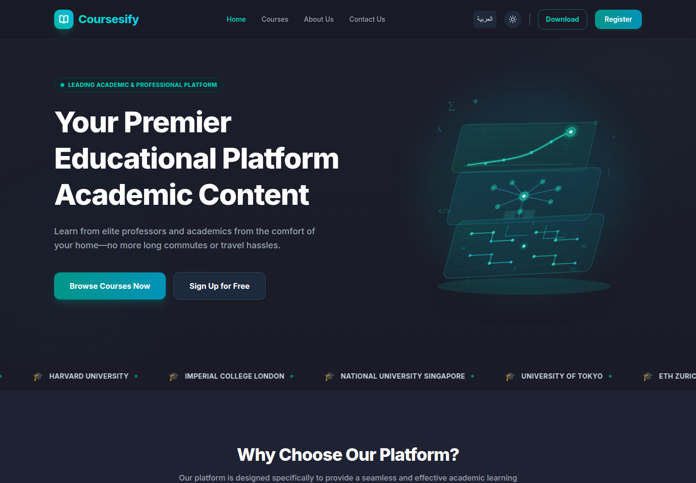
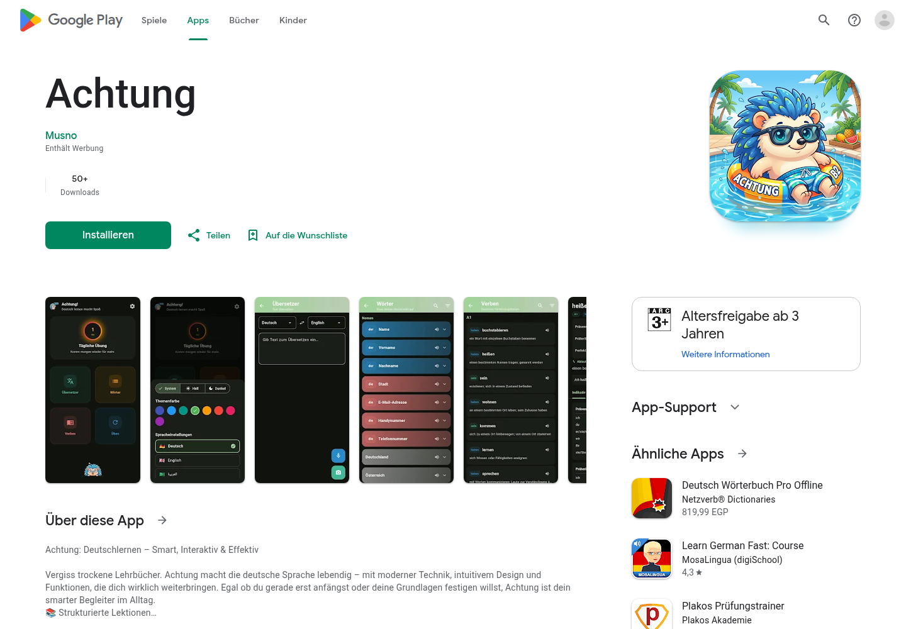
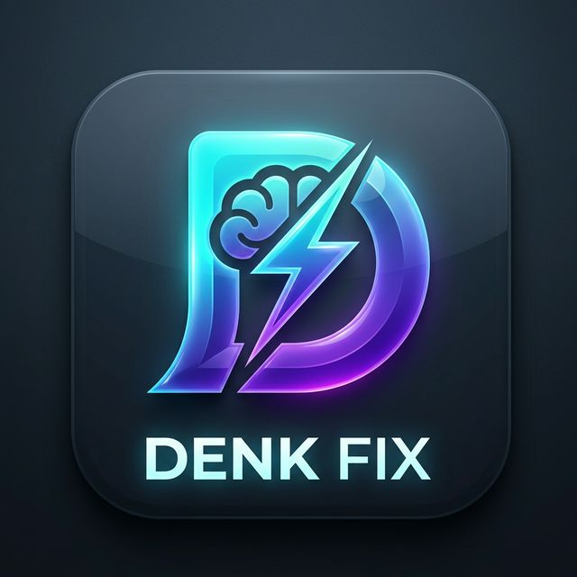
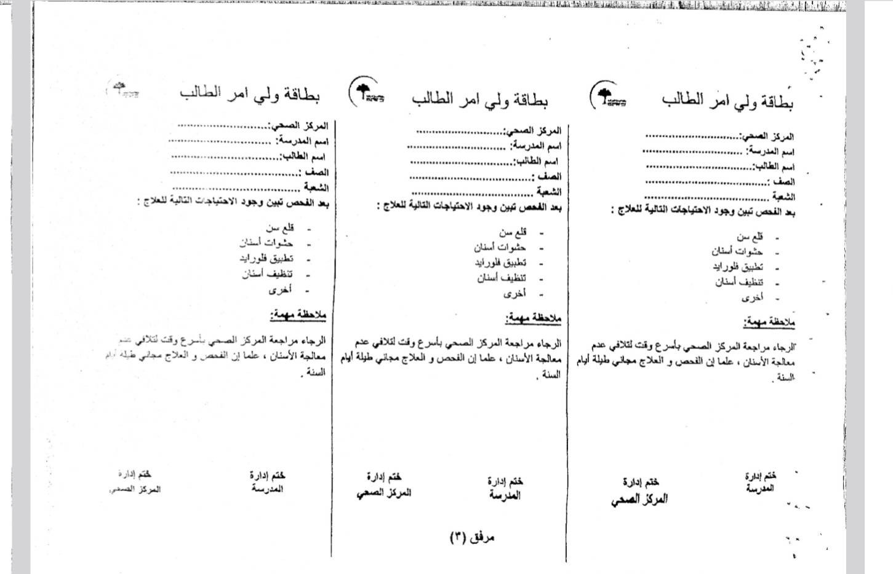
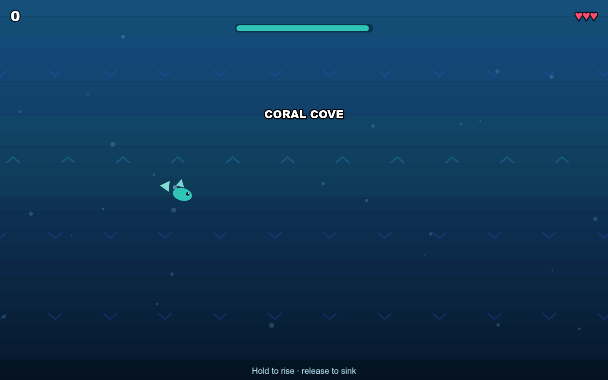

# Software Portfolio — Moustafa Askar

**Full-Stack · Mobile · Automatisierung**

Ich entwickle plattformübergreifende Anwendungen – von der Web-Plattform über die Desktop-App bis zur mobilen App. Mein Fokus liegt auf nachvollziehbaren Datenmodellen, sauberer Struktur und Produkten, die im Alltag funktionieren.

Aktuell suche ich eine **Ausbildung als Fachinformatiker für Anwendungsentwicklung (m/w/d)** zum **01.08.2027** (früher möglich). Ich bin umzugsbereit nach Deutschland (Ausbildungsvisum erforderlich); die B2-Prüfung möchte ich dort ablegen.

## Arbeitsweise

Ich entwickle meine Projekte eigenständig und nutze moderne KI-Werkzeuge als
Unterstützung für Recherche, Boilerplate und schnelleres Iterieren. Anforderungen,
Architektur, Datenmodelle und die Integration der Komponenten verantworte ich
selbst und kann die zentralen Entscheidungen im Code erklären.

---

## Ausgewählte Projekte

### Coursesify — E-Learning- & Streaming-Plattform

Live-MVP einer Bildungsplattform mit Kursverwaltung, Nutzerkonten und Video-Streaming. Dazu eine Electron-Desktop-App mit Schutzmechanismen gegen unbefugtes Kopieren.

`Next.js` · `Node.js` · `Electron` · `PostgreSQL` · `Supabase`

**[Live ansehen](https://coursesify.vercel.app/en)** · **[Case Study](projects/coursesify.md)**

---

### Achtung — Offline-First Sprachlern-App

  

Mobile Lern-App für Deutsch (A1/A2) mit Offline-Übersetzung, OCR-Scanner, Aussprachetraining und Vokabeljournal. Veröffentlicht im Google Play Store.

`Flutter` · `Dart` · `SQLite/Drift` · `Google ML Kit` · `TTS/STT` · `OCR`

**[Google Play](https://play.google.com/store/apps/details?id=com.musno.achtung)** · **[Case Study](projects/achtung.md)**

---

### Denk Fix Online — Echtzeit-Multiplayer-Lernspiel

  

Browserbasiertes Mehrspieler-Spiel zum deutschen Wortschatzaufbau mit Raum-Codes, Live-Ranking, serverautoritativer Zeitsteuerung und PWA-Unterstützung.

`React` · `Node.js` · `Socket.IO` · `PWA`

**[Repository](https://github.com/Musn0o/Denk-Fix-Online)**

---

### Mayo — Digitale Befunderfassung

  

Mobile und Desktop-Anwendung zur Digitalisierung von Befunden im schulzahnmedizinischen Bereich: Offline-Datenhaltung, Speech-to-Text, CSV-Import/Export und PDF-Berichte. Wird täglich von einer zahnmedizinischen Fachkraft und weiteren Anwendern genutzt.

`Kotlin/Android` · `Room` · `Python/PySide6` · `Speech-to-Text` · `PDF`

**[Repository](https://github.com/Musn0o/Mayo)** · **[Case Study](projects/mayo.md)**

---

### Undertow — Browser-Arcade-Spiel

  

Endless-Unterwasser-Arcade-Spiel für YouTube Playables mit Cloud-Saves, Rewarded Ads, Daily Missions und vollständig zur Laufzeit generierten Assets.

`TypeScript` · `Phaser 3` · `Vite`

**[Live spielen](https://musn0o.github.io/undertow/)** · **[Repository](https://github.com/Musn0o/undertow)**

---

### Weitere Projekte

| Projekt | Beschreibung | Stack | Link |
| --- | --- | --- | --- |
| **ClipStitch** | Lokale KI-gestützte Videoproduktion: Szenenplanung, Voiceover, FFmpeg-Assembly | Python, Gradio, FFmpeg, TTS, LLM-APIs | [Repository](https://github.com/Musn0o/clipstitch) |
| **Depth-Mesh** | Blender-Add-on: Bild → Tiefenkarte → 3D-Mesh mittels ONNX | Python, Blender, ONNX | [Repository](https://github.com/Musn0o/Depth-Mesh) |
| **Gemma-3-270M LoRA** | Fine-Tuning eines Sprachmodells für Deutsch↔Englisch-Übersetzung | Python, PEFT/LoRA, Hugging Face | [Repository](https://github.com/Musn0o/G3_270M_GE_translate) |
| **LebenslaufPro** | Streamlit-App zur Erstellung deutscher Bewerbungsmappen mit Typst | Python, Streamlit, Typst | [Repository](https://github.com/Musn0o/LebenslaufPro) |

---

## Technischer Überblick

- **Sprachen:** TypeScript, JavaScript, Python, Dart, Kotlin, SQL, HTML/CSS
- **Frontend:** React, Next.js, Flutter, Phaser, PySide6
- **Backend:** Node.js, Express, Socket.IO, REST-APIs
- **Datenbanken:** PostgreSQL, SQLite, Supabase, Room, Drift
- **Tools:** Git/GitHub, GitHub Actions, Linux, VS Code, Android Studio, Electron, Vercel, Netlify
- **KI & Medien:** Google ML Kit, ONNX, LoRA/PEFT, LLM-APIs, FFmpeg, TTS/STT, OCR

---

## Kontakt

**Moustafa Askar**  
Alexandria, Ägypten · umzugsbereit nach Deutschland  
E-Mail: [askarmoustafa@yahoo.com](mailto:askarmoustafa@yahoo.com)  
GitHub: [github.com/Musn0o](https://github.com/Musn0o)
