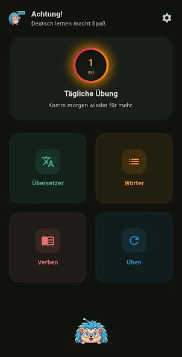
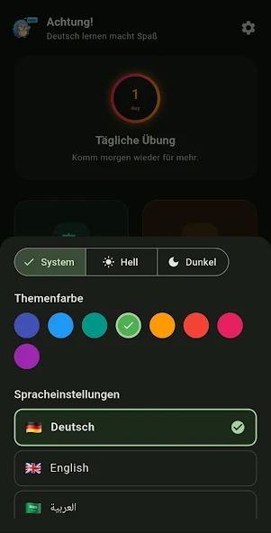
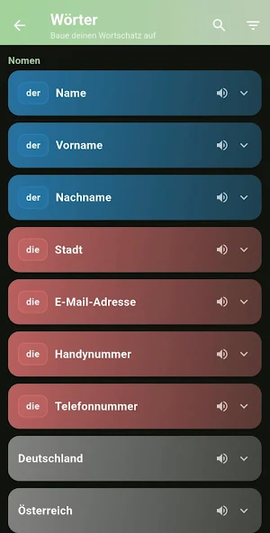
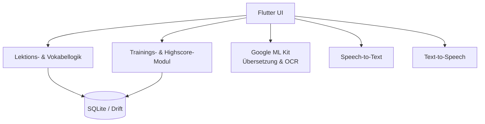

# Achtung — Offline-First Sprachlern-App

**Status:** Im Google Play Store veröffentlicht, aktive Weiterentwicklung  
**Rolle:** Konzeption, Entwicklung, Veröffentlichung (Solo-Projekt)  
**Google Play:** [Achtung](https://play.google.com/store/apps/details?id=com.musno.achtung)  
**Quellcode:** privat (Demo auf Anfrage)

  
  
  

## Überblick

Achtung ist eine mobile Lern-App für Deutsch auf den Niveaustufen A1 und A2. Der Schwerpunkt liegt auf einer schnellen, offline verfügbaren Nutzung: Übersetzungen, Vokabeln, Verbkonjugationen und Aussprache sollen auch ohne ständige Internetverbindung funktionieren.

Die App wurde im Google Play Store veröffentlicht und dort bereits über 50-mal installiert.

## Meine Rolle

Ich habe die App eigenständig konzipiert, entwickelt und veröffentlicht:

- Definition des Funktionsumfangs und der Datenstruktur
- Implementierung der Flutter-Oberfläche
- Aufbau der lokalen Datenbank mit SQLite/Drift
- Integration von Google ML Kit, TTS, Speech-to-Text und OCR
- Veröffentlichung und Pflege im Google Play Store

## Funktionen

- Strukturierte Lektionen für A1 und A2
- Vollständige Verbkonjugationstabellen (Indikativ, Konjunktiv I/II, Imperativ)
- Automatische Erkennung von transitiven Verben sowie von „haben“/„sein“ als Hilfsverb
- Vokabeljournal mit Artikel, Plural und Erklärungen
- Offline-Übersetzung Deutsch ↔ Englisch und Deutsch ↔ Arabisch über Google ML Kit
- OCR-Scanner für Texte auf Schildern, Speisekarten usw.
- Aussprachetraining mit Text-to-Speech und Speech-to-Text
- Personalisierte Übungssessions und Highscore-System
- Mehrsprachige Oberfläche (Deutsch, Englisch, Arabisch)

## Architektur

**Mobile:** Flutter, Dart  
**Lokale Daten:** SQLite, Drift  
**KI & Medien:** Google ML Kit, TTS, STT, OCR  
**Plattform:** Android (Google Play)

## Offline-First-Ansatz

Die App ist so aufgebaut, dass Kernfunktionen ohne Netzwerkzugriff nutzbar bleiben. Übersetzungen laufen über das lokale ML-Kit-Modell, Vokabeln und Konjugationen liegen in der lokalen Datenbank, und die Aussprache kann über die auf dem Gerät installierten Stimmen erfolgen. Online-Dienste werden nur dort benötigt, wo sie einen echten Mehrwert bieten.

## Herausforderungen & Lösungen

1. **Komplexe Verbkonjugationen:** Aufbau einer strukturierten Logik für Zeitformen, Hilfsverben und transitive/intransitive Verben.
2. **Offline-Verfügbarkeit:** Lokale Datenhaltung mit Drift und Nutzung der On-Device-Fähigkeiten von ML Kit.
3. **Mehrsprachige Oberfläche:** Berücksichtigung von Deutsch, Englisch und Arabisch inklusive RTL-Layout.

## Was das Projekt zeigt

- Entwicklung und Veröffentlichung einer echten Mobile-App
- Arbeiten mit lokalen Datenbanken und Offline-First-Architektur
- Integration mehrerer Gerätefunktionen (Kamera/OCR, Mikrofon/STT, TTS)
- Produktpflege über die Veröffentlichung hinaus

## Links

- **Google Play:** https://play.google.com/store/apps/details?id=com.musno.achtung
- **Datenschutz:** https://musn0o.github.io/achtung-privacy-policy/
- **GitHub:** https://github.com/Musn0o
