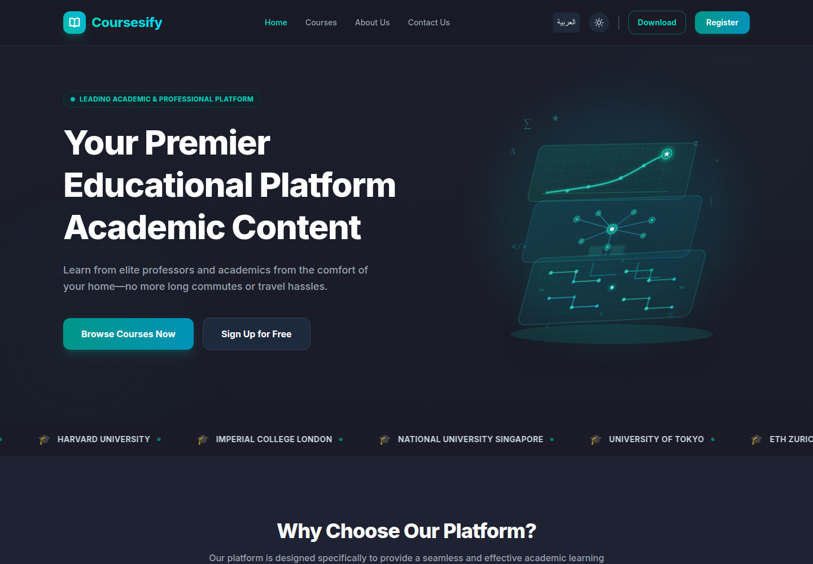
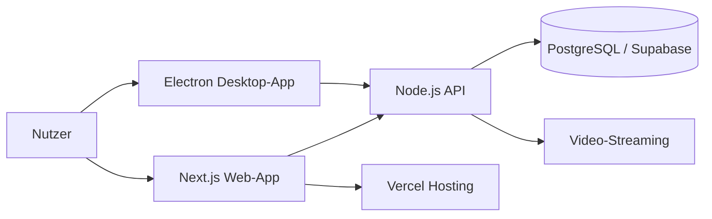

# Coursesify — E-Learning- & Streaming-Plattform

**Status:** Live-MVP, aktive Weiterentwicklung  
**Rolle:** Konzeption, Full-Stack-Entwicklung, Desktop-App, Sicherheit, Betrieb  
**Live:** [coursesify.vercel.app/en](https://coursesify.vercel.app/en)  
**Quellcode:** privat (Demo und Architektur-Einblick auf Anfrage)

## Überblick

Coursesify ist eine Bildungsplattform für akademische und berufliche Online-Kurse. Nutzer können Kurse entdecken, sich registrieren und Videoinhalte streamen. Für die geschützte Bereitstellung von Inhalten wurde zusätzlich eine native Desktop-Anwendung entwickelt.

Das Projekt ist als Live-MVP online und wird kontinuierlich in den Bereichen Nutzererfahrung, Sicherheit und Performance weiterentwickelt. Es befindet sich noch im Aufbau; öffentliche Nutzerzahlen liegen daher nicht vor.

## Meine Rolle

Als Solo-Entwickler habe ich das Projekt von der ersten Idee bis zum Live-Betrieb umgesetzt:

- Anforderungsanalyse und Strukturierung der Kurs- und Nutzerdaten
- Full-Stack-Implementierung der Web-Plattform
- Entwicklung der Electron-Desktop-App
- Umsetzung von Schutzmechanismen gegen unbefugtes Kopieren
- Deployment, Konfiguration und laufende Verbesserung

## Funktionen

- Kurskatalog mit Kategorien und Detailseiten
- Registrierung und Nutzerkonten
- Video-Streaming für Kursinhalte
- Native Desktop-App auf Basis von Electron
- Dynamische Wasserzeichen und Browser-Isolierung zum Schutz von Inhalten
- Zweisprachige Oberfläche (Deutsch/Englisch, Arabisch)
- Responsive Web-Oberfläche

## Architektur

**Frontend:** Next.js, React, TypeScript, Tailwind/CSS  
**Backend:** Node.js, REST-APIs  
**Datenbank:** PostgreSQL über Supabase  
**Desktop:** Electron  
**Hosting:** Vercel

## Sicherheit & Inhaltsschutz

Ein zentrales Ziel war es, Videoinhalte gegen einfaches Herunterladen und Weitergeben zu schützen. Dafür wurden unter anderem dynamische Wasserzeichen in die Wiedergabe integriert und die Desktop-App so isoliert, dass Inhalte nicht ohne Weiteres aus dem Anwendungsfenster extrahiert werden können. Die Maßnahmen sind als zusätzliche Hürde zu verstehen, nicht als absoluter Kopierschutz.

## Herausforderungen & Lösungen

1. **Schutz von Videoinhalten:** Kombination aus kontrolliertem Streaming, Wasserzeichen und isolierter Desktop-Wiedergabe.
2. **Plattformübergreifende Bereitstellung:** Web-App und Electron-Client teilen dieselbe API, unterscheiden sich aber in Wiedergabe und Sicherheitsmodell.
3. **Datenmodell:** Kurse, Lektionen, Nutzer und Fortschritt mussten so strukturiert werden, dass sie sowohl im Web als auch im Desktop-Client konsistent funktionieren.

## Was das Projekt zeigt

- Full-Stack-Entwicklung über Web, API und Desktop
- Arbeiten mit PostgreSQL/Supabase und Authentifizierung
- Sicherheitsdenken bei der Auslieferung von Medieninhalten
- Eigenständige Produktentwicklung von der Idee bis zum Deployment

## Links

- **Live:** https://coursesify.vercel.app/en
- **GitHub:** https://github.com/Musn0o
- **Kontakt:** askarmoustafa@yahoo.com
