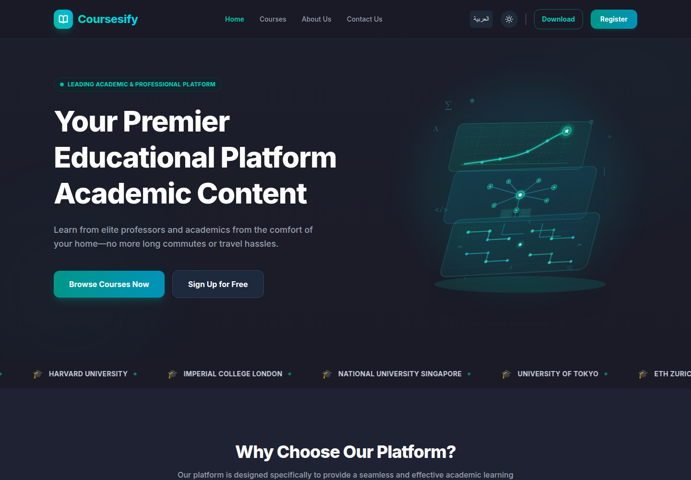
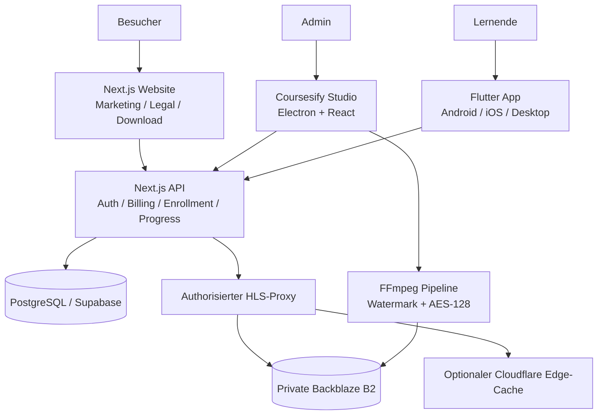

# Coursesify — Geschützte E-Learning-Plattform

**Status:** Live-MVP, aktive Weiterentwicklung  
**Rolle:** Konzeption, Full-Stack-Entwicklung, Flutter-App, Admin-Tool, Sicherheit, Betrieb  
**Live:** [coursesify.vercel.app/en](https://coursesify.vercel.app/en)  
**Quellcode:** privat (`Coursesify`, `coursesify-uploader`) — Architektur-Einblick und Demo auf Anfrage

## Überblick

Coursesify besteht aus drei miteinander verbundenen Teilen:

1. **Öffentliche Website + API (`apps/web`):** Next.js-Anwendung auf Vercel. Die Website dient heute als Marketing-, Legal-, Kontakt- und Download-Seite. Im selben Projekt liegen die API mit Auth, Abrechnungsprüfung, Berechtigungen, Einschreibung, Fortschritt und der autorisierten HLS-Videoauslieferung.
2. **Flutter-Lern-App (`apps/client_app`):** Die eigentliche Lernclient-Anwendung für Android, iOS, Windows, macOS und Linux. Sie ist der einzige Client, der Lektionen abspielt.
3. **Coursesify Studio (`coursesify-uploader`):** Internes Electron-Control-Panel für Administratoren. Es ersetzt manuelle Code-/Datenbankänderungen durch eine Oberfläche für Kurse, Studierende, Bestellungen, Freigaben, Promos, Fakultät, Löschungsanfragen und die HLS-Upload-Pipeline.

Das Projekt ist als Live-MVP online und wird kontinuierlich in den Bereichen Nutzererfahrung, Sicherheit und Performance weiterentwickelt. Öffentliche Nutzerzahlen liegen noch nicht vor.

## Meine Rolle

Als Solo-Entwickler habe ich die drei Teile konzipiert und umgesetzt:

- Aufbau der Next.js-Website und der API inklusive Datenmodell mit Prisma/PostgreSQL (Supabase)
- Implementierung sicherer Auth-, Einschreibungs- und Abrechnungsabläufe
- Entwicklung der Flutter-Lern-App für fünf Plattformen
- Umsetzung des geschützten HLS-Playbacks mit Gerätebindung und Wasserzeichen
- Entwicklung des Electron-Admin-Tools inklusive FFmpeg/AES-128-Upload-Pipeline
- Betrieb, Konfiguration und laufende Verbesserung

## Funktionen

### Website & API
- Marketing-Seite mit Kursübersicht, Download-Button und mehrsprachiger Oberfläche
- Privacy Policy, Nutzungsbedingungen und Kontaktinformationen
- Registrierung, Login und Admin-Login
- Manuelle Abrechnungsprüfung und Freigabe von Einschreibungen
- Enrollment-, Device-, Progress- und Qbank-Datenmodell
- Videoauslieferung ausschließlich über autorisierte Proxy-Routen (`/api/video-stream`, `/api/video-key`)

### Flutter-Lern-App
- Plattformübergreifend: Android, iOS, Windows, macOS, Linux
- HLS-Playback über `media_kit`
- Gerätebindung und Geräteverifikation
- Dynamisches Student-ID-Wasserzeichen
- Screen-Capture-Schutz auf Android/iOS
- Lokale Speicherung sensitiver Daten via `flutter_secure_storage`
- Fortschrittsverfolgung und Lerninhalte

### Coursesify Studio (intern)
- Verwaltung von Kursen, Modulen, Lektionen und Syllabus
- Studierendenverwaltung, Bestellungen und Freigaben
- Promo-Codes, Fakultät, Featured Previews und Löschungsanfragen
- HLS-Encoding mit FFmpeg: Wasserzeichen + AES-128-Verschlüsselung
- Upload in einen privaten Backblaze-B2-Bucket und automatische Verknüpfung mit der Lektion
- Admin-API-Calls statt direkter Datenbankzugriffe

## Architektur

**Website/API:** Next.js, React, TypeScript, NextAuth, Prisma, PostgreSQL/Supabase, Vercel  
**Lern-App:** Flutter, Dart, Riverpod, go_router, Dio, media_kit, flutter_secure_storage, screen_protector  
**Admin-Tool:** Electron, React, Vite, Tailwind, FFmpeg/ffprobe, electron-store  
**Infrastruktur:** Backblaze B2, optionaler Cloudflare Worker

## Sicherheit & Inhaltsschutz

Der ursprüngliche Browser-Player ließ sich zu einfach aufzeichnen oder herunterladen. Deshalb wurde die Wiedergabe in die Flutter-App verlagert:

- Medien liegen nie als direkte B2-/S3-URL vor, sondern werden über autorisierte API-Routen ausgeliefert.
- Jede Anfrage prüft Session, Berechtigung und Einschreibung.
- Die HLS-Segmente sind AES-128-verschlüsselt.
- Die App bindet Geräte und zeigt ein dynamisches Wasserzeichen mit der Student-ID.
- Auf mobilen Geräten wird Screen-Capture erschwert.

Das ist Abschreckung und Nachverfolgbarkeit, kein absoluter DRM-Schutz — kein Client-Player kann Screen-Recording vollständig verhindern.

## Herausforderungen & Lösungen

1. **Piraterie-Schutz:** Verlagerung der Wiedergabe vom Browser in die Flutter-App plus autorisierte HLS-Proxy-Routen, AES-128, Wasserzeichen und Gerätebindung.
2. **Admin-Aufwand:** Einführung von Coursesify Studio, damit Inhalte und Freigaben über eine UI statt über Code oder direkte Datenbankzugriffe verwaltet werden.
3. **Cross-Platform-Playback:** Einheitliche HLS-Wiedergabe über `media_kit` auf fünf Plattformen mit plattformspezifischen Schutzmaßnahmen.
4. **Konsistentes Datenmodell:** Kurse, Module, Lektionen, Nutzer, Einschreibungen, Geräte, Fortschritt und Abrechnungen in einem Prisma-Schema.

## Was das Projekt zeigt

- Full-Stack-Entwicklung über Website, API und Datenbank
- Cross-Platform-App-Entwicklung mit Flutter
- Security-by-Design bei der Auslieferung von Videoinhalten
- Internes Developer-Tool mit Electron und FFmpeg-Pipeline
- Eigenständige Produktentwicklung von der Idee bis zum Live-Betrieb

## Links

- **Live:** https://coursesify.vercel.app/en
- **Hauptprojekt:** `Musn0o/Coursesify` (privat)
- **Admin-Tool:** `Musn0o/coursesify-uploader` (privat)
- **Kontakt:** askarmoustafa@yahoo.com
