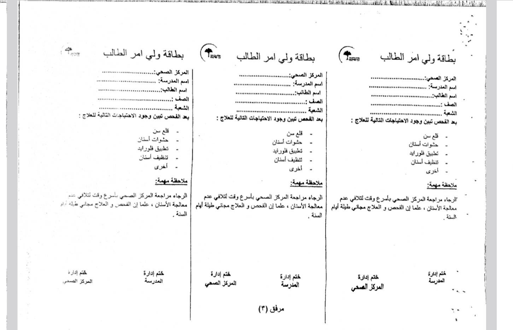
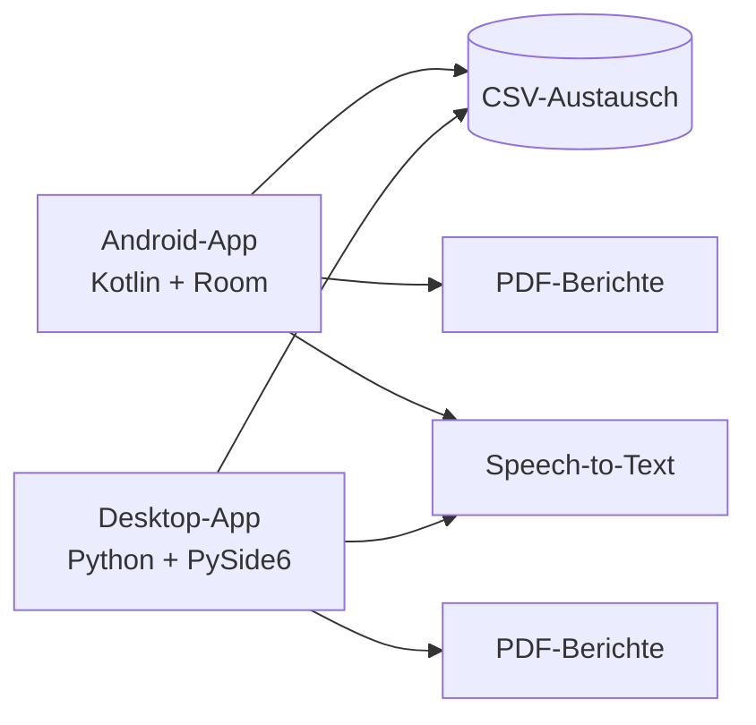

# Mayo — Digitale Befunderfassung

**Status:** Im täglichen Einsatz, öffentliches Repository  
**Rolle:** Konzeption und Entwicklung (Solo-Projekt)  
**Repository:** [github.com/Musn0o/Mayo](https://github.com/Musn0o/Mayo)  
**Release:** [Mayo v1.0.0](https://github.com/Musn0o/Mayo/releases)

## Überblick

Mayo digitalisiert die Erfassung von zahnmedizinischen Befunden im schulischen Umfeld. Die Anwendung besteht aus einer Android-App (Kotlin) und einer Desktop-Version (Python/PySide6). Beide Varianten arbeiten offline und tauschen Daten über CSV aus.

Die Desktop-Version wird täglich von einer zahnmedizinischen Fachkraft genutzt; weitere Anwender haben die App ebenfalls übernommen, um ihren Arbeitsablauf zu beschleunigen.

## Funktionen

- Schnelle Erfassung von Schule, Klasse, Schüler/in und Diagnose
- Spracheingabe für Namen und Befunde
- Offline-Datenhaltung über SQLite/Room
- PDF-Berichte für Eltern und Zusammenfassungen
- CSV-Import und -Export zwischen Android und Desktop
- Arabische RTL-Oberfläche mit eingebetteter Schrift
- Windows-Executable über PyInstaller

## Architektur

## Was das Projekt zeigt

- Cross-Platform-Entwicklung mit zwei Technologie-Stacks
- Lokale Datenhaltung und Offline-Betrieb
- Speech-to-Text und PDF-Generierung
- Entwicklung einer Anwendung mit direktem Nutzen im Arbeitsalltag

## Links

- **Repository:** https://github.com/Musn0o/Mayo
- **Release:** https://github.com/Musn0o/Mayo/releases
